<div align="center">

# 🛰️ Conexão para Todos

### Jogo educativo em pixel art sobre **inclusão digital, acessibilidade e cidadania**

Explore a cidade de **Conecta**, ajude os moradores a enfrentar barreiras tecnológicas<br>
e transforme a tecnologia em oportunidade para todo mundo — **sozinho ou em dupla**.

<p>
  
  
  
</p>
<p>
  
  
  
  
  
</p>

**[▶️ Como jogar](#-como-executar) · [🎮 Controles](#-controles) · [📋 Missões](#-as-10-missões) · [📜 Roteiro completo](docs/ROTEIRO.md) · [🧪 Testes](#-testes)**

<br>

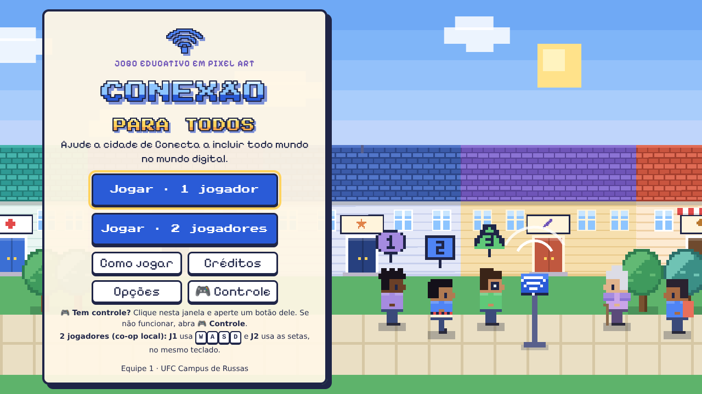

</div>

---

## ✨ Sobre o projeto

Na cidade de **Conecta**, muita coisa só funciona pelo celular ou pela internet: marcar uma consulta, estudar, falar com a Prefeitura, vender pão. Quem não tem aparelho, sinal ou prática **não está “atrasado”** — está sem as oportunidades certas.

Você lidera três **Agentes de Inclusão Digital** que conversam com os moradores, descobrem as barreiras e criam soluções **com** a comunidade, nunca **no lugar** dela. Cada decisão muda três **status coletivos** da cidade: **Acesso**, **Acessibilidade** e **Conhecimento**.

> 🎓 Trabalho da **Equipe 1 — UFC, Campus de Russas**.
> **Tema:** *Analfabetismo Digital, Acessibilidade e Exclusão Tecnológica: Desafios e Caminhos para a Cidadania na Era Digital.*

## 🧑‍🤝‍🧑 Conheça os agentes

<div align="center">
  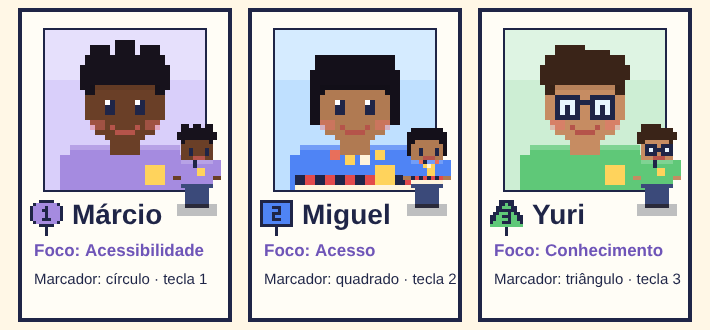
</div>

| Agente | Foco | Marcador | Posto no Portal Conecta+ |
|---|---|---|---|
| **Márcio** | ♿ Acessibilidade: leitores de tela, contraste e acesso para pessoas com deficiência | ● círculo · tecla `1` | Leitor de tela |
| **Miguel** | 📶 Acesso: redes, aparelhos simples e conexão fraca | ■ quadrado · tecla `2` | Conexão lenta |
| **Yuri** | 📖 Conhecimento: explicar passo a passo, com paciência e linguagem simples | ▲ triângulo · tecla `3` | Linguagem simples |

## 🌟 Destaques

| | |
|---|---|
| 🏙️ **Exploração 2D em pixel art** | Cidade com 9 locais para **descobrir**, placas de curiosidade, minimapa e seta de objetivo |
| 👥 **Co-op local para 2 jogadores** | **J1 com `WASD`** e **J2 com as setas**, cada um com seu agente, no mesmo teclado (ou com 2 controles). No **celular** o jogo é só de **1 jogador** |
| 🧭 **Equipe de 3 agentes (marcadores)** | **Márcio ●**, **Miguel ■** e **Yuri ▲**, cada um com uma especialidade |
| 📊 **Status com efeitos reais** | O que você decide muda a cidade: Wi-Fi que acende, rampas que surgem, dicas que liberam |
| 🧩 **10 missões variadas** | Escolhas com consequência, achar barreiras e golpes, relacionar pessoas e recursos, planejar uma oficina, coletar itens e uma missão **cooperativa** |
| 🔁 **Sem “game over”** | Escolheu mal? O jogo explica o porquê e você tenta de novo — **errar ensina** |
| 🎮 **Teclado, toque ou controle** | Jogue com teclado, na tela do celular ou com **gamepad** (Xbox, PlayStation, Switch Pro), inclusive em dupla |
| ♿ **Acessível por design** | Sem tempo limite, teclado/mouse/toque, alto contraste, texto maior, reduzir animações, nada só por cor |
| 📦 **Zero dependências** | HTML + CSS + JS puro. **Arte, sons e música gerados por código**, sem imagens nem serviços externos |

## 📸 Capturas de tela

<table>
  <tr>
    <td align="center">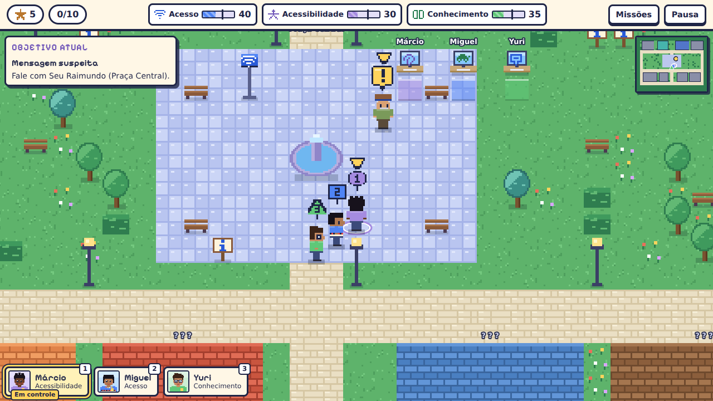<br><sub><b>Explorar</b> a cidade e descobrir missões</sub></td>
    <td align="center">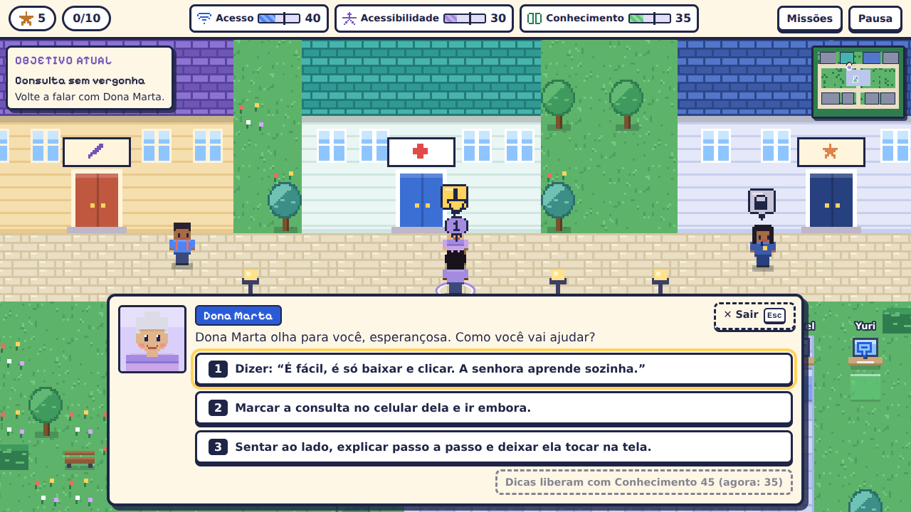<br><sub><b>Conversar</b> e escolher como ajudar</sub></td>
  </tr>
  <tr>
    <td align="center">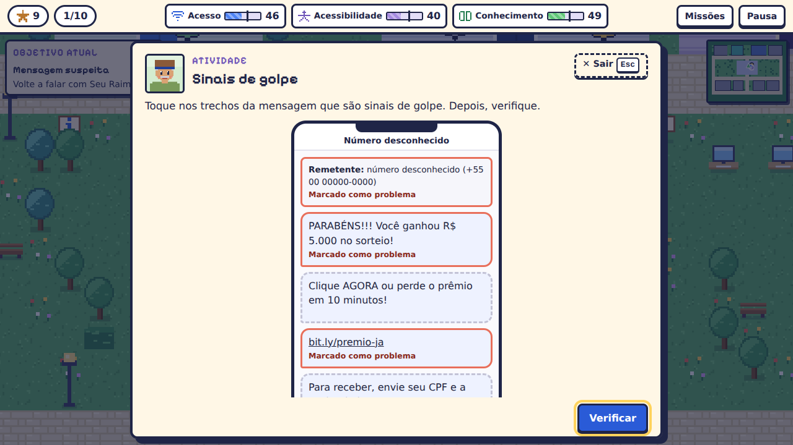<br><sub><b>Aprender</b> a reconhecer golpes</sub></td>
    <td align="center">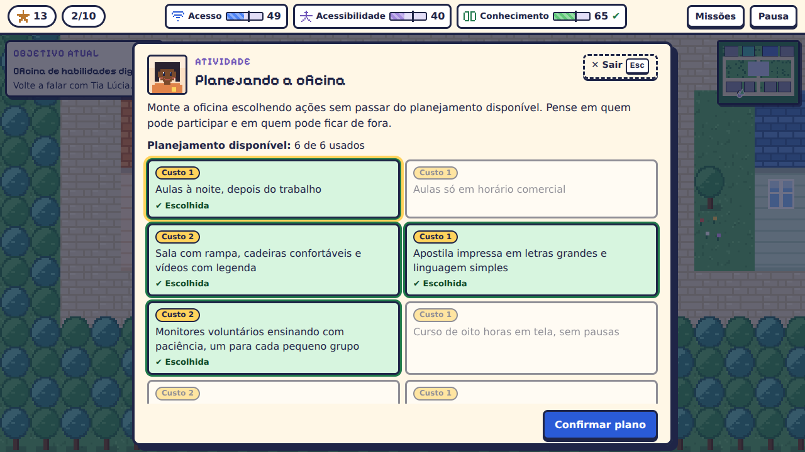<br><sub><b>Planejar</b> pensando em quem pode ficar de fora</sub></td>
  </tr>
  <tr>
    <td align="center">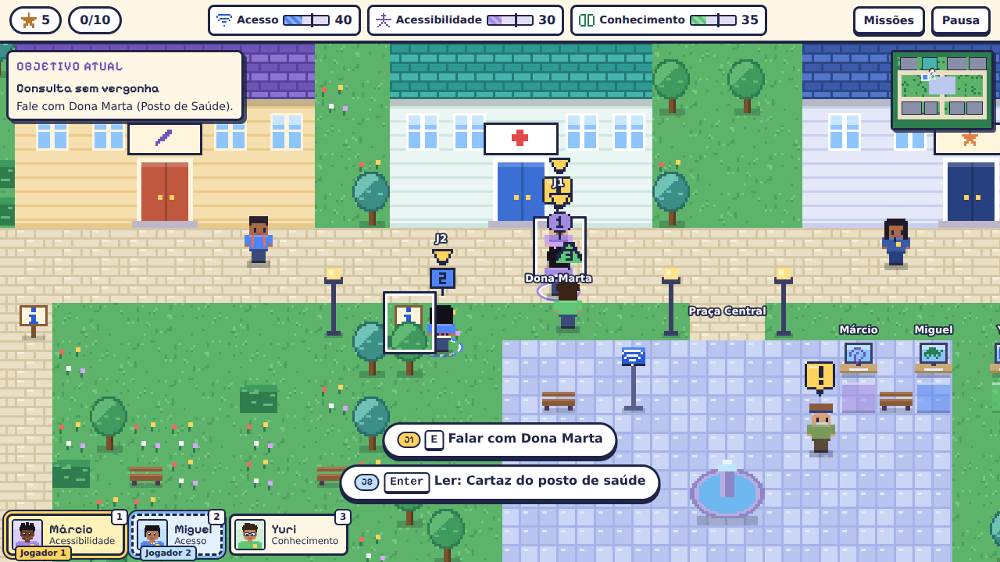<br><sub><b>Co-op local</b>: J1 e J2 jogando juntos</sub></td>
    <td align="center">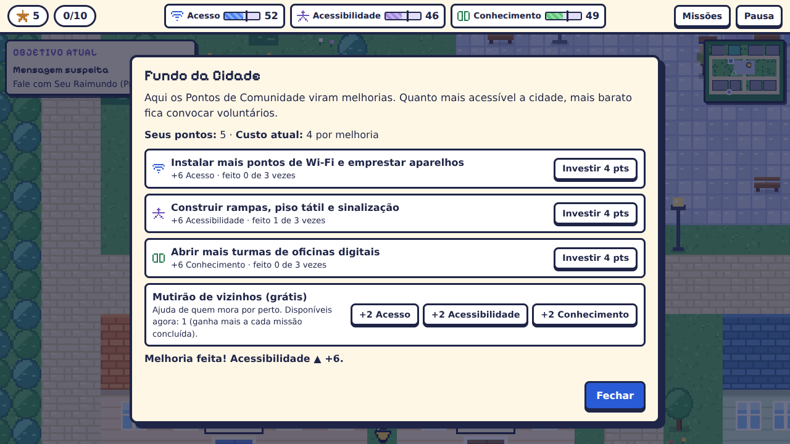<br><sub><b>Fundo da Cidade</b>: pontos viram melhorias</sub></td>
  </tr>
  <tr>
    <td align="center">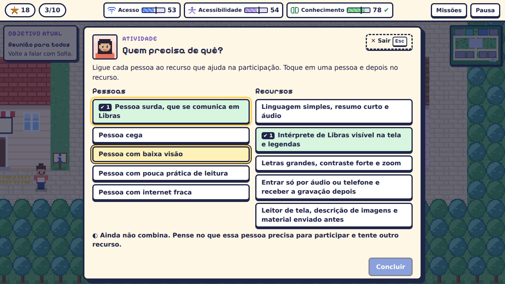<br><sub><b>Relacionar</b> cada pessoa ao recurso certo</sub></td>
    <td align="center">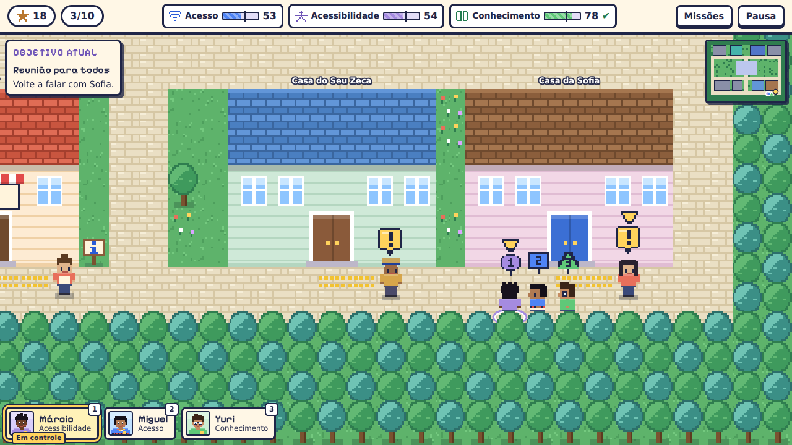<br><sub><b>Novos locais</b>: casas de Seu Zeca e Sofia</sub></td>
  </tr>
  <tr>
    <td align="center" colspan="2">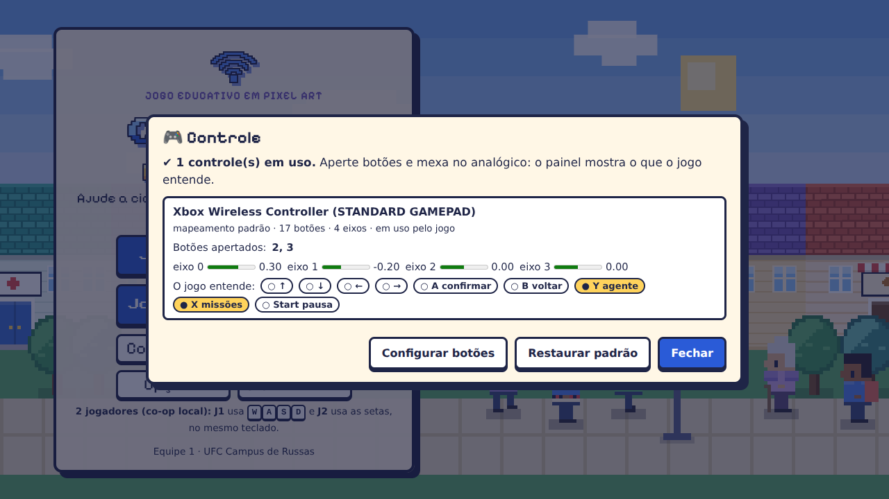<br><sub><b>Painel 🎮 Controle</b>: veja ao vivo o que o navegador detecta e configure os botões</sub></td>
  </tr>
  <tr>
    <td align="center" colspan="2">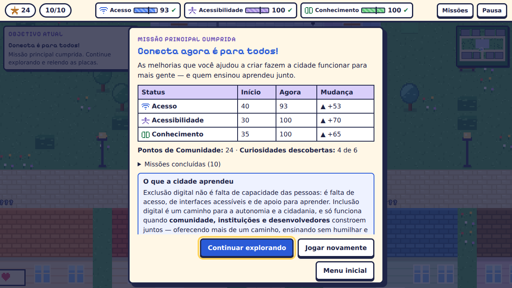<br><sub><b>Vitória</b>: o que a cidade aprendeu</sub></td>
  </tr>
</table>

<div align="center">
  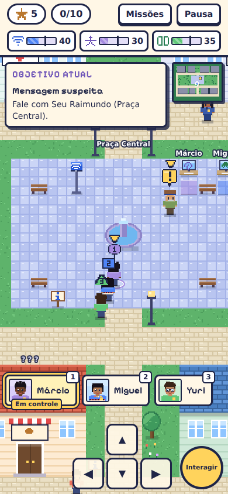
  &nbsp;&nbsp;&nbsp;
  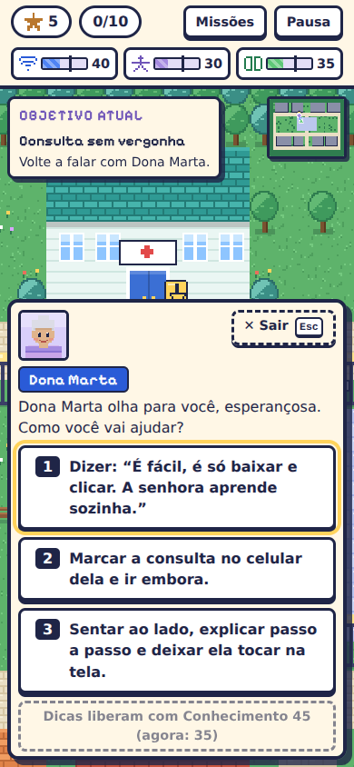
  <br><sub>📱 Funciona no celular, com controles de toque</sub>
</div>

## 🚀 Como executar

**Opção 1 — direto no navegador (mais simples):** baixe o projeto, dê dois cliques em `index.html` e jogue no Chrome, Edge, Firefox ou Safari. Não precisa de internet nem de instalação.

**Opção 2 — servidor local:**

```bash
git clone https://github.com/SEU-USUARIO/conexao-para-todos.git
cd conexao-para-todos
python3 -m http.server 8000     # abra http://localhost:8000
```

**Opção 3 — publicar no GitHub Pages:** em **Settings → Pages**, escolha **Deploy from a branch → `main` / `(root)`**. O jogo ficará em `https://SEU-USUARIO.github.io/conexao-para-todos/`.

## 🎮 Controles

### 👥 Dois jogadores (mesmo teclado)

| Ação | 🟡 Jogador 1 | 🔵 Jogador 2 |
|---|---|---|
| Andar | `W` `A` `S` `D` | `↑` `←` `↓` `→` |
| Interagir | `E` ou `Espaço` | `Enter` |
| Trocar de agente | `Q` (ou `1` `2` `3`) | `Shift` direito (ou `Num 1` `Num 2` `Num 3`) |

> **Sair a qualquer momento:** em qualquer conversa ou atividade, `Esc` ou **✕ Sair** fecha a janela. A missão continua de onde parou, e o que já foi decidido fica salvo (não dá para repetir um ganho de status).
>
> Nos retratos da equipe: **clique** = Jogador 1 · **Shift + clique** = Jogador 2. Se um pega o agente do outro, os dois **trocam de agente**.
> A câmera acompanha a dupla e há um **“elástico”**: os dois não conseguem se afastar além da tela um do outro.

### 🎮 Com controle (gamepad)

Conecte um controle de **Xbox, PlayStation, Switch Pro** ou similar e aperte qualquer botão: o jogo reconhece sozinho (funciona em Chrome, Edge e Firefox). Dá para jogar **do menu inicial até a vitória sem teclado**.

| Ação | Botão |
|---|---|
| Andar | analógico esquerdo ou direcional |
| Interagir / confirmar | **A** (✕ no PlayStation) |
| Sair ou voltar | **B** (○) |
| Trocar de agente | **Y** ou **RB** = próximo · **LB** = anterior (percorre os **3**) |
| Missões | **X** (□) ou **Select** |
| Pausa | **Start** |
| Escolher respostas e navegar nos menus | direcional ou analógico + **A** |

No **modo dupla**: com **2 controles**, o primeiro é do Jogador 1 e o segundo do Jogador 2. Com **1 controle**, ele fica com o **Jogador 2** (e o Jogador 1 joga no teclado). Se os dois controles ficarem trocados (o do Jogador 1 na mão do Jogador 2), use **Trocar J1 ↔ J2** no painel **🎮 Controle**: ele também mostra qual jogador cada controle será. Dá para desligar o controle em **Opções**.

<details>
<summary><b>🛠️ O controle não funcionou? Faça este teste</b></summary>

<br>

1. Na tela inicial (ou no menu de pausa), abra **🎮 Controle**. O painel mostra **ao vivo** o que o navegador enxerga: nome do controle, botões apertados, eixos do analógico e o que o jogo entendeu.
2. **Nenhum controle aparece?** Clique em qualquer lugar da janela do jogo e **aperte um botão do controle**. Os navegadores só mostram o controle depois disso e apenas para a janela em foco. Em controles sem fio, confira se estão ligados e pareados.
3. **Aparece, mas os botões não batem?** Use **Configurar botões** no mesmo painel: o assistente pergunta qual botão é o A, B, Y, X e Start e qual é o sentido do analógico, e salva a configuração para aquele controle. **Restaurar padrão** desfaz.
4. Funciona em **Chrome, Edge e Firefox** atualizados. Abra o jogo pelo arquivo `index.html` ou por `http://localhost` (controles são bloqueados em páginas não seguras).
5. Controles "fantasmas" (por exemplo, o sensor de movimento do controle de PlayStation, que o navegador lista como um gamepad à parte) são ignorados automaticamente.

</details>

### 🧍 Um jogador

| Ação | Teclado | Toque / mouse |
|---|---|---|
| Andar | `W A S D` ou setas | setas na tela |
| Interagir | `E`, `Espaço` ou `Enter` | botão **Interagir** |
| Trocar de agente | `Tab`/`Q` ou `1` `2` `3` | clicar no retrato |
| Escolher resposta | `1` `2` `3` ou clique | toque |
| Missões / Pausa | `M` / `Esc` ou `P` | botões do topo |
| **Sair de uma conversa ou atividade** | `Esc` | botão **✕ Sair** |

## 📋 As 10 missões

| # | Missão | Local | Quem pede ajuda | O que se aprende | Tipo de desafio |
|:-:|---|---|---|---|---|
| 1 | **Consulta sem vergonha** | Posto de Saúde | Dona Marta | Ensinar sem humilhar; manter app, balcão e telefone | Escolhas + ordenar passos |
| 2 | **Portal difícil de usar** | Prefeitura | Beto | Barreiras de acessibilidade em serviços online | Achar problemas numa tela |
| 3 | **Estudar sem internet estável** | Escola | Thiago | Wi-Fi comunitário, aparelhos emprestados, estudo offline | Explorar e coletar + escolha |
| 4 | **Mensagem suspeita** | Praça Central | Seu Raimundo | Golpes, pressa, links falsos e senhas fortes | Achar sinais de golpe + escolhas |
| 5 | **Oficina de habilidades digitais** | Centro Comunitário | Tia Lúcia | Planejar pensando em quem pode ficar de fora | Planejar com orçamento |
| 6 | **Padaria na internet** | Padaria | Dona Neide | Presença digital simples, Pix seguro, canais alternativos | Três decisões encadeadas |
| 7 | **Computadores para todos** | Biblioteca | Joana | Tecnologia assistiva para necessidades diferentes | Configurar 3 computadores |
| 8 | **Benefício sem atravessador** | Casa do Seu Zeca | Seu Zeca | Conta gov.br é gratuita; ninguém precisa pagar para "facilitar"; códigos de verificação não se compartilham | Escolhas + ordenar passos |
| 9 | **Reunião para todos** | Casa da Sofia | Sofia | Libras, legendas e outros recursos: cada pessoa participa de um jeito | Relacionar + achar problemas + escolha |
| 10 | **Portal Conecta+** | Prefeitura | Prefeita Helena | Inclusão digital é responsabilidade compartilhada | 🤝 **Cooperativa**: um posto para cada agente |

> 🔒 A missão 10 (finale cooperativo) só abre depois de **7 missões concluídas**.
> 📜 Diálogos, opções, efeitos e finais de todas as missões estão no **[roteiro completo](docs/ROTEIRO.md)**.

## 📊 Status e pontos

| Status | Começa em | Efeito real no jogo |
|---|:-:|---|
| 📶 **Acesso** | 40 | +1 ponto extra por missão a cada 25 de Acesso. Com **≥ 50**, os postes de Wi-Fi da cidade acendem |
| ♿ **Acessibilidade** | 30 | Melhorias do Fundo ficam mais baratas. Com **≥ 50** surge piso tátil; com **≥ 75**, rampas nas entradas |
| 📖 **Conhecimento** | 35 | A partir de **45**, o Yuri oferece **dicas** nas escolhas |

🏁 **Vitória:** concluir as **10 missões** e levar os **três status a pelo menos 60**.
⭐ **Pontos de Comunidade** pagam melhorias no **Fundo da Cidade**; os **mutirões** gratuitos garantem que o jogo nunca fique sem saída.

## 🧱 Estrutura do jogo (conforme o enunciado)

| Elemento | Como aparece no jogo |
|---|---|
| 🌍 **Espaço = Exploração** | Mapa 2D com locais que se **revelam** ao chegar perto, minimapa, placas e seta de objetivo |
| 🧍 **Atores = Marcadores** | Agentes com marcador próprio (forma + número + cor) e moradores com balões `!` `…` `✔` |
| 🎒 **Itens = Status** | Acesso, Acessibilidade, Conhecimento e Pontos de Comunidade |
| 🤝 **Desafios = Cooperação** | Missões que exigem trabalho em equipe entre agentes e, em dupla, entre jogadores |

## ♿ Acessibilidade do próprio jogo

- ⏱️ Sem limite de tempo; texto curto e em linguagem simples
- ⌨️ Teclado, mouse, toque **e controle (gamepad)**; botões na tela para quem não usa teclado
- 🎨 Informação **nunca só por cor**: ícones, formas, rótulos e números
- 🔠 Opções de **texto maior**, **alto contraste** e **reduzir animações** (respeita `prefers-reduced-motion`)
- 🎵 Música de fundo (uma trilha calma no título e outra animada na cidade) com caixa própria em **Opções**; 🔇 sons opcionais: o jogo funciona totalmente no mudo
- 📱 No celular, segurar as setas não seleciona texto nem abre o menu do sistema
- 🧠 Dicas opcionais, sem punição por errar

## 🛠️ Tecnologias

- **HTML5 Canvas 2D** para o mundo em pixel art e **Web Audio API** para sons e música
- **CSS3** responsivo (desktop e celular), sem frameworks
- **JavaScript puro**, sem bibliotecas e sem etapa de build
- Toda a arte (tiles, prédios, personagens, retratos, marcadores) e todos os sons são **gerados por código**

## 📁 Estrutura de arquivos

```
conexao-para-todos/
├── index.html              # página do jogo
├── styles.css              # interface (HUD, diálogos, modais, responsivo)
├── fonts.css               # fontes pixel embutidas (base64), geradas por tools/embed-fonts.js
├── js/
│   ├── sprites.js          # pixel art gerada por código
│   ├── world.js            # mapa, prédios, moradores, placas, itens, colisões
│   ├── player.js           # agentes: movimento (1 ou 2 jogadores), seguidores, troca
│   ├── dialogue.js         # diálogos e escolhas com retorno
│   ├── activities.js       # ordenar, achar problemas, planejar, Fundo, resumo de missão
│   ├── missions.js         # dados das 10 missões e motor de passos
│   ├── game.js             # estado, laço principal, câmera, desenho, entrada, status, vitória
│   ├── ui.js               # HUD, pausa, opções, tutorial, créditos, tela de título
│   ├── gamepad.js          # suporte a controles (Gamepad API)
│   ├── audio.js            # sons e música de fundo com Web Audio
│   └── main.js             # inicialização
├── docs/
│   ├── ROTEIRO.md          # roteiro completo do jogo
│   └── screenshots/        # capturas de tela
├── tools/
│   ├── gerar-roteiro.js    # gera docs/ROTEIRO.md a partir dos dados do jogo
│   └── embed-fonts.js      # gera fonts.css a partir de assets/fonts/*.woff2
└── tests/
    ├── test.html           # testes de lógica (abrir no navegador)
    ├── tests.js
    ├── run-tests.mjs       # roda test.html em navegador headless
    └── e2e-playthrough.mjs # partida completa pela interface real
```

## 🧪 Testes

**Testes de lógica (sem instalar nada):** abra `tests/test.html` no navegador. São **68 verificações**: mapa alcançável, colisões, status e efeitos reais, validade das missões, equilíbrio, portal, vitória, **sair de conversas e atividades** (sem travar e sem repetir ganhos) e o **modo co-op** (movimento independente, troca de agentes, elástico, alvos por jogador).

**Partida completa automática (opcional, Node 18+):**

```bash
npm i puppeteer
node tests/run-tests.mjs           # testes de lógica no terminal
node tests/e2e-playthrough.mjs     # joga o jogo inteiro pela interface real
```

O teste ponta a ponta cobre (inclusive **jogar com controle simulado**, em 1 e 2 jogadores): tutorial, **sair no meio de conversas e atividades com `Esc` e com o botão Sair**, escolha ruim com nova tentativa, portal bloqueado, coleta de itens, cooperação com agente errado e certo, vitória, tela de celular e uma **partida em dupla com teclas reais** (`WASD` para o J1, setas para o J2).

**Atualizar o roteiro** depois de mudar missões ou textos:

```bash
node tools/gerar-roteiro.js
```

## 📜 Documentação

- **[Roteiro completo do jogo](docs/ROTEIRO.md)**: história, personagens, mapa, regras e o passo a passo de cada missão com diálogos, opções e consequências.

## 🔤 Fontes

O logotipo usa **Press Start 2P** e os títulos usam **Pixelify Sans**, ambas sob a licença **SIL Open Font License 1.1** (uso livre, inclusive comercial). Os arquivos e as licenças estão em `assets/fonts/` e ficam embutidos em `fonts.css`, então o jogo funciona offline.

## 👥 Créditos

Desenvolvido pela **Equipe 1** da **Universidade Federal do Ceará (UFC) — Campus de Russas**.
Personagens, cidade e situações são **fictícios**.

<div align="center">
<br>

**Inclusão digital é tarefa da cidade inteira.** 💙

</div>
