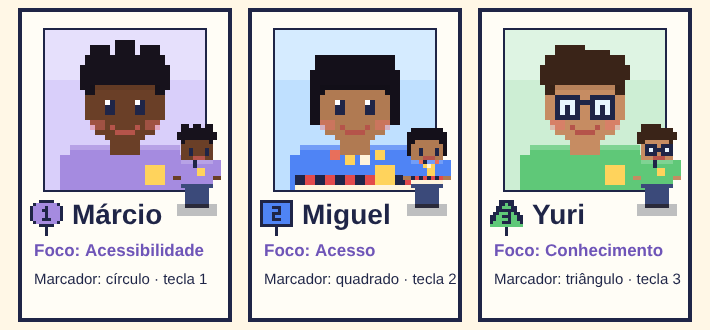

# 📜 Roteiro do jogo — Conexão para Todos

> Documento de referência com **tudo o que existe no jogo**: história, personagens, mapa, regras, status e o passo a passo completo de cada missão (diálogos, escolhas, atividades e consequências).
> As seções de missões são geradas automaticamente a partir dos dados do jogo (`node tools/gerar-roteiro.js`), então refletem fielmente o que está implementado.

## Índice

- 1. Visão geral
- 2. História
- 3. Equipe de agentes (marcadores)
- 4. Moradores de Conecta
- 5. Mapa e locais
- 6. Placas e pontos de interesse
- 7. Regras: status, pontos e Fundo da Cidade
- 8. Como as escolhas funcionam
- 9. Modo dupla (co-op local) e controle
- 10. Roteiro das 8 missões
- 11. Final e vitória
- 12. Apêndice: quadro de efeitos por missão

## 1. Visão geral

**Conexão para Todos** é um jogo educativo em pixel art, de exploração 2D, sobre **inclusão digital, acessibilidade e exclusão tecnológica**. O jogador (ou a dupla) explora a cidade fictícia de **Conecta**, conversa com moradores, descobre barreiras e escolhe como resolvê-las, melhorando três **status coletivos** da cidade.

| Item | Descrição |
|---|---|
| Gênero | Exploração 2D com missões, escolhas com consequência e cooperação |
| Jogadores | 1 jogador, ou **2 jogadores no mesmo teclado** (co-op local) |
| Duração estimada | cerca de 30 a 45 minutos lendo com calma (10 missões) |
| Objetivo | Concluir as **10 missões** e levar **Acesso, Acessibilidade e Conhecimento a pelo menos 60** |
| Derrota | **Não existe.** Escolhas ruins mostram a consequência e permitem tentar de novo |
| Tema acadêmico | *Analfabetismo Digital, Acessibilidade e Exclusão Tecnológica: Desafios e Caminhos para a Cidadania na Era Digital* (Equipe 1 · UFC Russas) |

### Estrutura pedida no trabalho

| Elemento | No jogo |
|---|---|
| **Espaço = Exploração** | Mapa de Conecta com 9 locais que são **descobertos** ao chegar perto, placas de curiosidade, minimapa e seta de objetivo |
| **Atores = Marcadores** | Agentes **Márcio ● círculo**, **Miguel ■ quadrado** e **Yuri ▲ triângulo**; moradores com balões `!` `…` `✔` |
| **Itens = Status** | Acesso, Acessibilidade, Conhecimento e Pontos de Comunidade, com efeitos reais no jogo |
| **Desafios = Cooperação** | 10 missões; a última exige os **três agentes** (e, em dupla, os dois jogadores combinando as tarefas) |

## 2. História

**Tela 1 — Bem-vindo(a) a Conecta**

> Conecta é uma cidade pequena e acolhedora. Mas muita coisa por lá só funciona pelo celular ou pela internet: marcar consulta, estudar, falar com a Prefeitura, vender pão.
> Quem não tem aparelho, sinal ou prática não está “atrasado”: está sem as oportunidades certas.

**Tela 2 — Sua equipe: Agentes de Inclusão Digital**

> Você lidera **Márcio**, **Miguel** e **Yuri**. Juntos, vão conversar com os moradores, achar as barreiras e criar soluções **com** a comunidade — nunca **no lugar** dela.
> Cada pequena ação faz diferença. Vamos começar?

Em seguida vem o **tutorial** de 5 telas (explorar, conversar, status, objetivo e controle), que pode ser pulado. No começo da partida o jogo aponta o primeiro objetivo com uma **seta amarela**.

## 3. Equipe de agentes (marcadores)

**Márcio** tem pele negra e cabelo cacheado curto; **Miguel** tem traços indígenas, cabelo liso com franja, colar de miçangas e uma faixa de grafismo na camisa; **Yuri** é pardo, de cabelo ondulado e óculos. Os três vestem o crachá da equipe.

| Agente | Marcador | Especialidade | Status que representa | Posto do Portal Conecta+ |
|---|---|---|---|---|
| **Márcio** | ● círculo (número 1) | Especialista em acessibilidade: leitores de tela, contraste e acesso para pessoas com deficiência. | Acessibilidade | leitor de tela |
| **Miguel** | ■ quadrado (número 2) | Especialista em acesso: redes, aparelhos simples e conexão fraca. | Acesso | conexão lenta |
| **Yuri** | ▲ triângulo (número 3) | Especialista em ensino: explica passo a passo, com paciência e linguagem simples. | Conhecimento | linguagem simples |

- O jogador controla um agente por vez e os outros **seguem em fila**; a troca é feita com `Tab`/`Q`/`1`/`2`/`3` ou clicando no retrato.
- O marcador (forma + número, o mesmo da tecla de troca) aparece sobre o agente e no minimapa, então **nunca depende só da cor**.

## 4. Moradores de Conecta

| Morador | Quem é | Onde fica | Missão |
|---|---|---|---|
| **Dona Marta** | Moradora | Posto de Saúde | 1. Consulta sem vergonha |
| **Beto** | Atendente da Prefeitura | Prefeitura | 2. Portal difícil de usar |
| **Thiago** | Estudante | Escola Municipal | 3. Estudar sem internet estável |
| **Seu Raimundo** | Morador | Praça Central | 4. Mensagem suspeita |
| **Tia Lúcia** | Coordenadora do Centro Comunitário | Centro Comunitário | 5. Oficina de habilidades digitais |
| **Dona Neide** | Dona da padaria | Padaria Pão & Prosa | 6. Padaria na internet |
| **Joana** | Bibliotecária | Biblioteca Comunitária | 7. Computadores para todos |
| **Seu Zeca** | Agricultor | Casa do Seu Zeca | 8. Benefício sem atravessador |
| **Sofia** | Representante da associação de surdos | Casa da Sofia | 9. Reunião para todos |
| **Prefeita Helena** | Prefeita de Conecta | Prefeitura | 10. Portal Conecta+ (em equipe) |

Balões sobre os moradores: `!` missão disponível · `…` em andamento · `✔` concluída · 🔒 bloqueada (só o Portal Conecta+). O balão só aparece depois de **descobrir** o local.

## 5. Mapa e locais

Mapa de **44×34 tiles**. Um local é **descoberto** ao entrar perto dele: aparece o aviso “Local descoberto”, o nome passa a ser exibido no mapa e o morador ganha o balão de missão. Antes disso o nome aparece como `? ? ?`.

| Local | O que acontece lá | Missão |
|---|---|---|
| **Escola Municipal** | Escola Municipal, onde estuda Thiago. | 3. Estudar sem internet estável |
| **Posto de Saúde** | Posto de Saúde, onde Dona Marta precisa de ajuda. | 1. Consulta sem vergonha |
| **Prefeitura** | Prefeitura, com o atendente Beto, a Prefeita Helena e os **3 postos de teste** do Portal. | 2. Portal difícil de usar 10. Portal Conecta+ (em equipe) |
| **Biblioteca Comunitária** | Biblioteca Comunitária, com Joana e **3 computadores públicos** no pátio. | 7. Computadores para todos |
| **Centro Comunitário** | Centro Comunitário, com Tia Lúcia e o **Quadro do Fundo da Cidade**. | 5. Oficina de habilidades digitais |
| **Padaria Pão & Prosa** | Padaria Pão & Prosa, de Dona Neide. | 6. Padaria na internet |
| **Casa do Seu Zeca** | Casa do Seu Zeca, que precisa de uma conta gov.br e de apoio para não cair em golpes. | 8. Benefício sem atravessador |
| **Casa da Sofia** | Casa da Sofia, que representa a associação de surdos e quer uma reunião acessível. | 9. Reunião para todos |
| **Praça Central** | Fonte, bancos e **poste de Wi-Fi comunitário**. Ponto de partida do jogo. | 4. Mensagem suspeita |

O mapa é cercado por árvores. O **minimapa** (canto da tela) mostra locais descobertos, os agentes (com suas formas) e o objetivo atual. Uma **seta na borda da tela** aponta o objetivo quando ele está fora de vista.

## 6. Placas e pontos de interesse

Cada placa lida pela primeira vez dá **+1 Ponto de Comunidade** (“Curiosidade descoberta”). São 6 placas:

| Placa | Texto |
|---|---|
| **Quadro de avisos da escola** | Aula online exige aparelho e internet. Quando falta um dos dois, o aluno fica para trás — e a culpa não é dele. |
| **Cartaz do posto de saúde** | Marcação pelo aplicativo OU no balcão. Duas portas, mesma consulta. |
| **Placa da Prefeitura** | Serviço digital bom funciona com teclado, leitor de tela, contraste forte e linguagem simples. |
| **Placa do Wi-Fi da praça** | Wi-Fi gratuito ajuda muita gente. Em rede aberta, evite digitar senhas e dados do banco. |
| **Mural da biblioteca** | Ensinar sem humilhar: pergunte, mostre uma vez e deixe a pessoa tentar com as próprias mãos. |
| **Cartaz da padaria** | Pix só pelo QR Code ou chave oficial. Quem pede pressa e dados demais merece desconfiança. |

Outros pontos interativos:

- **Poste de Wi-Fi comunitário** (Praça): o texto muda conforme o Acesso da cidade; com Acesso ≥ 50 ele passa a emitir ondas de sinal.
- **Quadro do Fundo da Cidade** (Centro Comunitário): investir pontos e chamar mutirões (veja a seção 7).
- **Computadores e postos de teste**: usados nas missões 7 e 8; fora das missões mostram apenas uma mensagem informativa.

## 7. Regras: status, pontos e Fundo da Cidade

### Status coletivos (0 a 100)

| Status | Valor inicial | O que representa | Efeito real no jogo |
|---|---|---|---|
| **Acesso** | 40 | Aparelhos, internet e serviços ao alcance de todos | +1 Ponto de Comunidade extra por missão a cada 25 de Acesso; com **≥ 50**, os postes de Wi-Fi se iluminam |
| **Acessibilidade** | 30 | Quanto lugares e serviços atendem pessoas com diferentes necessidades | Melhorias do Fundo ficam mais baratas (−1 com **≥ 50**, −2 com **≥ 75**); com ≥ 50 surge **piso tátil** e com ≥ 75 **rampas** nas entradas |
| **Conhecimento** | 35 | Capacidade da comunidade de usar a tecnologia com autonomia e segurança | A partir de **45**, o Yuri oferece **dicas** nas escolhas e atividades |

A **meta é 60** em cada um (marcada com um traço na barra e com ✔ quando atingida). Tocar/clicar numa barra abre o painel de status com explicações, efeitos e o diário das últimas mudanças.

### Pontos de Comunidade

- Início: **5 pontos**.
- Cada missão concluída: **+3** (mais o bônus de Acesso).
- Cada placa lida pela primeira vez: **+1**.
- Finalizar o Portal Conecta+ em equipe: **+5**.

### Fundo da Cidade e Mutirão (Centro Comunitário)

| Ação | Custo | Efeito | Limite |
|---|---|---|---|
| Instalar mais pontos de Wi-Fi e emprestar aparelhos | 4 pts (−1/−2 com Acessibilidade alta, mínimo 2) | Acesso +6 | 3 vezes |
| Construir rampas, piso tátil e sinalização | idem | Acessibilidade +6 | 3 vezes |
| Abrir mais turmas de oficinas digitais | idem | Conhecimento +6 | 3 vezes |
| **Mutirão de vizinhos (grátis)** | 0 | +2 no status escolhido | 1 + número de missões concluídas (nunca deixa o jogo sem saída) |

## 8. Como as escolhas funcionam

Cada decisão tem **três níveis**, sempre explicados no jogo:

| Nível | O que acontece |
|---|---|
| ✅ **Ótima escolha** | Maior ganho nos status; a missão segue |
| 🟡 **Funciona, mas dá para melhorar** | Ganho menor, com explicação do que faltou; a missão segue |
| ❌ **Ainda não é o melhor caminho** | Pequena perda; o jogo explica a consequência e o jogador **tenta outra opção** (a opção já tentada fica marcada) |

**Sair no meio:** em qualquer conversa ou atividade o jogador pode apertar `Esc` (ou clicar em **✕ Sair**). A missão continua de onde parou: as etapas já decididas ficam salvas e **não dá para repetir um ganho de status**; a etapa em andamento recomeça na próxima visita. Se o jogador sair depois de concluir o último posto da missão cooperativa, o bônus de equipe é concedido mesmo assim (uma única vez).

Além das escolhas, há atividades: **ordenar passos**, **achar barreiras/golpes** (com opção de tentar de novo), **planejar com orçamento**, **coletar itens** pelo mapa e **configurar postos de trabalho**.

Ao concluir cada missão o jogo mostra **estrelas (1 a 3)** conforme a qualidade das escolhas, as mudanças nos status, os pontos ganhos e um quadro **“Você sabia?”** com o aprendizado.

## 9. Modo dupla (co-op local) e controle

| Ação | Jogador 1 | Jogador 2 |
|---|---|---|
| Andar | `W` `A` `S` `D` | setas |
| Interagir | `E` ou `Espaço` | `Enter` |
| Trocar de agente | `Q` (ou `1` `2` `3`) | `Shift` direito (ou `Num 1` `Num 2` `Num 3`) |

**Controle (gamepad):** reconhecido sozinho (Xbox, PlayStation, Switch Pro e similares); dá para jogar do menu inicial até a vitória sem teclado.

| Ação | Botão |
|---|---|
| Andar | analógico esquerdo ou direcional |
| Interagir / confirmar | **A** (✕ no PlayStation) |
| Sair ou voltar | **B** (○) |
| Trocar de agente | **Y** ou **RB** = próximo · **LB** = anterior (percorre os 3) |
| Missões | **X** (□) ou **Select** |
| Pausa | **Start** |
| Respostas e menus | direcional ou analógico + **A** |

**Se o controle não funcionar:** na tela inicial (ou na pausa) o botão **🎮 Controle** abre um painel que mostra, ao vivo, o que o navegador detecta (nome do controle, botões, eixos) e um assistente para configurar os botões de controles com mapeamento diferente. Dispositivos "fantasmas" (como o sensor de movimento do controle de PlayStation) são ignorados.

Em dupla: com **2 controles**, o 1º é do Jogador 1 e o 2º do Jogador 2; com **1 controle**, ele fica com o **Jogador 2**. Se os controles ficarem trocados, o botão **Trocar J1 ↔ J2** do painel 🎮 Controle inverte. A dica de interação mostra **A** quando o jogador está usando o controle. É possível desligar o controle em **Opções**.

- Cada jogador controla **um agente** ao mesmo tempo; o terceiro agente acompanha o Jogador 1.
- Qualquer um pode conversar, pegar itens e ler placas; **quem interagiu fala pelo seu agente**, e os dois podem escolher as respostas.
- A câmera acompanha o meio da dupla e há um **“elástico”**: os dois não conseguem se afastar além da tela um do outro.
- Nos retratos da equipe: clique = Jogador 1, `Shift`+clique = Jogador 2. Se um pega o agente do outro, os dois **trocam de agente**.
- Na missão final, cada posto exige um agente diferente: a dupla precisa **combinar quem vai a cada posto**.

## 10. Roteiro das 10 missões

Ordem **livre**, exceto a missão 10 (**Portal Conecta+**), que só abre depois de **7 missões concluídas**. Ordem sugerida: Praça → Posto de Saúde → Prefeitura (Beto) → Escola → Centro Comunitário → Padaria → Biblioteca → Casa do Seu Zeca → Casa da Sofia → Prefeitura (Helena).

**Legenda dos passos:** 💬 conversa · 🔀 escolha · 🔢 ordenar · 🔎 achar problemas · 🔗 relacionar · 🧩 planejar · 🧭 coletar · 🖥️ postos de trabalho

---

### Missão 1 — Consulta sem vergonha

| | |
|---|---|
| **Local** | Posto de Saúde |
| **Quem pede ajuda** | Dona Marta (Moradora) |
| **Situação** | Dona Marta precisa marcar uma consulta, mas o posto agora usa um aplicativo. |
| **Libera** | Ao descobrir o local |

**O que ensina:** Muita gente tem dúvida com aplicativos de serviços públicos. Ensinar sem humilhar e manter mais de um canal de atendimento (app, balcão e telefone) garante o direito à saúde para todos.

#### Passo 1

💬 **Conversa**

- **Dona Marta:** Bom dia! A moça do posto disse que a consulta com a cardiologista agora só se marca pelo aplicativo. Eu nunca usei isso... tenho vergonha de pedir ajuda.
- **Agente em ação (Márcio, Miguel ou Yuri):** Sem vergonha nenhuma, Dona Marta. Aplicativo novo confunde muita gente. Vamos resolver juntas.

#### Passo 2

🔀 **Escolha** — **Dona Marta:** “Dona Marta olha para você, esperançosa. Como você vai ajudar?”

*Dica do Yuri (com Conhecimento ≥ 45):* Ajudar de verdade é fazer a pessoa ganhar autonomia, sem fazer com que ela se sinta incapaz.

| Opção | Nível | Efeito nos status | O que o jogo explica |
|---|---|---|---|
| 1. Dizer: “É fácil, é só baixar e clicar. A senhora aprende sozinha.” | ❌ Ainda não é o melhor caminho (tenta de novo) | Conhecimento -2 | Dizer que é “fácil” faz a pessoa se sentir incapaz por não saber. Dona Marta ficou calada e disse que volta outro dia. |
| 2. Marcar a consulta no celular dela e ir embora. | 🟡 Funciona, mas dá para melhorar | Acesso +3, Conhecimento +1 | A consulta foi marcada hoje, mas na próxima vez ela vai depender de alguém de novo. Ajuda que não ensina resolve só o problema de agora. |
| 3. Sentar ao lado, explicar passo a passo e deixar ela tocar na tela. | ✅ Ótima escolha | Conhecimento +8, Acessibilidade +2 | Ela aprendeu fazendo, no ritmo dela, e saiu mais confiante. Ensinar sem humilhar cria autonomia. |

#### Passo 3

🔢 **Ordenar passos — “Passo a passo da consulta”** — Monte, na ordem certa, o caminho que Dona Marta vai seguir no aplicativo.

1. Abrir o aplicativo Saúde Conecta e entrar com o CPF
2. Tocar em “Marcar consulta”
3. Escolher a especialidade: Cardiologia
4. Escolher o dia e o horário
5. Confirmar e guardar o comprovante

*Dica:* Pense em como se faz com papel: primeiro a pessoa se identifica, depois diz o que quer, depois escolhe a data.

**Ao concluir:** Conhecimento +6, Acesso +2. *“Consulta marcada com as próprias mãos! “Agora eu sei fazer sozinha”, disse Dona Marta.”*

#### Passo 4

🔀 **Escolha** — **Agente em ação (Márcio, Miguel ou Yuri):** “O aplicativo só funciona em celular com internet. E quem não tem celular ou sinal? O que sugerir ao posto?”

*Dica do Yuri (com Conhecimento ≥ 45):* Pense em oferecer mais de um caminho para a mesma consulta.

| Opção | Nível | Efeito nos status | O que o jogo explica |
|---|---|---|---|
| 1. Deixar só o aplicativo: quem quiser que se vire. | ❌ Ainda não é o melhor caminho (tenta de novo) | Acessibilidade -3, Acesso -2 | Um serviço de saúde só digital deixa de fora idosos, pessoas sem celular e quem tem deficiência. O que é conveniente para uns exclui outros. |
| 2. Colocar um computador de uso livre no posto. | 🟡 Funciona, mas dá para melhorar | Acesso +5, Acessibilidade +2 | Ajuda quem não tem aparelho, mas ainda exige saber usar o sistema e depende da internet do posto. |
| 3. Manter também a marcação no balcão e por telefone, ao lado do aplicativo. | ✅ Ótima escolha | Acessibilidade +8, Acesso +4 | Com mais de um caminho, ninguém fica de fora: o app ajuda quem pode usar e o balcão atende quem não pode ou não quer. |

**Fecho da missão**

- **Dona Marta:** Muito obrigada, meu bem! Vou contar para as vizinhas que dá para aprender sem passar vergonha.

➡️ Resumo da missão: **+3 Pontos de Comunidade** (+ bônus de Acesso), estrelas de 1 a 3 e o quadro “Você sabia?”:

> Muita gente tem dúvida com aplicativos de serviços públicos. Ensinar sem humilhar e manter mais de um canal de atendimento (app, balcão e telefone) garante o direito à saúde para todos.

Quando o morador já foi ajudado, ele repete uma frase de agradecimento: *“Já marquei outra consulta sozinha, sabia? Obrigada por tudo, meu bem!”*

---

### Missão 2 — Portal difícil de usar

| | |
|---|---|
| **Local** | Prefeitura |
| **Quem pede ajuda** | Beto (Atendente da Prefeitura) |
| **Situação** | O portal de serviços da Prefeitura tem barreiras que afastam muita gente. |
| **Libera** | Ao descobrir o local |

**O que ensina:** Barreiras como contraste baixo, botões pequenos, imagens sem descrição, CAPTCHA só visual e linguagem difícil afetam pessoas com deficiência, idosos e quem tem pouca experiência. Testar com pessoas reais evita esses problemas.

#### Passo 1

💬 **Conversa**

- **Beto:** Oi! O portal da Prefeitura recebe pedidos de segunda via e reclamações, mas muita gente desiste no meio. Pode me ajudar a achar os problemas?
- **Agente em ação (Márcio, Miguel ou Yuri):** Claro, Beto. Vamos olhar a tela como se fosse a primeira vez de quem usa.

#### Passo 2

🔎 **Achar problemas — “Barreiras no portal”** (tela de site) — Toque nos trechos da tela que atrapalham o uso. Depois, verifique.

| Trecho da tela | É problema? | Explicação |
|---|---|---|
| Solicite aqui a sua 2ª via | 🚩 Sim | Texto cinza claro sobre fundo branco: quem enxerga pouco (ou usa o celular no sol) não consegue ler. Falta contraste. |
| Enviar | 🚩 Sim | O botão “Enviar” é minúsculo: difícil de tocar para quem tem tremor, dedos grandes ou pouca precisão. |
| [ foto do formulário ](sem texto alternativo) | 🚩 Sim | Imagem sem descrição em texto: o leitor de tela não consegue explicar a imagem a quem não enxerga. |
| Prove que você é humano: digite as letras da imagem (sem opção de áudio) | 🚩 Sim | CAPTCHA só visual bloqueia pessoas cegas ou com baixa visão. É preciso oferecer alternativa, como áudio. |
| Protocole o requerimento ensejando a tramitação regular do feito. | 🚩 Sim | Linguagem cheia de termos difíceis afasta quem tem pouca prática de leitura. Frases curtas e palavras simples ajudam todo mundo. |
| Falar com uma atendente (botão grande, texto escuro) | ✅ Não | Esse botão é grande, tem bom contraste e dá uma saída humana para quem trava. Bom exemplo! |
| Nome completo: [______________] (rótulo claro acima do campo) | ✅ Não | Campo com rótulo claro e bastante espaço para digitar. Está bom. |

Há **5 problemas**. O jogador marca, clica em **Verificar**, vê o resultado e pode **tentar de novo** ou seguir. Ganho proporcional ao que achou (máximo **Acessibilidade +14, Conhecimento +4**). *“Esses são os tipos de barreira que mais aparecem em serviços digitais.”*

*Dica:* Procure problemas de cor, de tamanho, de descrição de imagens, de alternativas e de linguagem.

#### Passo 3

🔀 **Escolha** — **Beto:** “Agora, quem deve consertar o portal e como garantir que ele fique bom para todos?”

*Dica do Yuri (com Conhecimento ≥ 45):* Quem entende o problema melhor é quem vive com ele: teste com pessoas diferentes, antes e depois de publicar.

| Opção | Nível | Efeito nos status | O que o jogo explica |
|---|---|---|---|
| 1. Deixar como está: quem não consegue usar pede ajuda a um parente. | ❌ Ainda não é o melhor caminho (tenta de novo) | Acessibilidade -3, Acesso -1 | Transformar a exclusão em “problema da família” tira a responsabilidade de quem criou o serviço. O portal é que precisa mudar. |
| 2. Só os desenvolvedores revisam o código e corrigem o que acharem necessário. | 🟡 Funciona, mas dá para melhorar | Acessibilidade +3 | Ajuda, mas sem ouvir quem tem dificuldades a equipe pode corrigir o que não era o problema e deixar passar o que importa. |
| 3. Prefeitura, desenvolvedores e moradores (incluindo pessoas com deficiência) testam juntos e corrigem em conjunto. | ✅ Ótima escolha | Acessibilidade +8, Conhecimento +3, Acesso +2 | Quando quem usa participa do teste, os problemas reais aparecem. Acessibilidade não é um “extra”: é parte do projeto desde o início. |

**Fecho da missão**

- **Beto:** Vou levar a lista para a equipe e marcar uma sessão de testes com moradores. Obrigado!

➡️ Resumo da missão: **+3 Pontos de Comunidade** (+ bônus de Acesso), estrelas de 1 a 3 e o quadro “Você sabia?”:

> Barreiras como contraste baixo, botões pequenos, imagens sem descrição, CAPTCHA só visual e linguagem difícil afetam pessoas com deficiência, idosos e quem tem pouca experiência. Testar com pessoas reais evita esses problemas.

Quando o morador já foi ajudado, ele repete uma frase de agradecimento: *“A equipe já está testando o portal com os moradores. Valeu pela ajuda!”*

---

### Missão 3 — Estudar sem internet estável

| | |
|---|---|
| **Local** | Escola Municipal |
| **Quem pede ajuda** | Thiago (Estudante) |
| **Situação** | Thiago precisa assistir às aulas, mas o sinal de casa cai toda hora e ele só tem o celular da mãe. |
| **Libera** | Ao descobrir o local |

**O que ensina:** Sem internet estável e sem aparelho, o estudante perde aulas por motivos que não são dele. Pontos de Wi-Fi comunitários, empréstimo de aparelhos e material para estudar offline reduzem a desigualdade de acesso.

#### Passo 1

💬 **Conversa**

- **Thiago:** Tenho aulas em vídeo para assistir, mas a internet de casa cai o tempo todo e só tenho o celular da minha mãe. Já perdi duas atividades...
- **Agente em ação (Márcio, Miguel ou Yuri):** Isso não é falta de esforço, Thiago: é falta de acesso. Vamos montar um plano!

#### Passo 2

🧭 **Explorar e coletar** — objetivo: *Encontre os 3 itens brilhantes pela cidade*

- **Thiago:** Preciso de três coisas: um aparelho para estudar, um lugar com Wi-Fi para baixar as aulas e um material para ler quando não tiver internet.
- **Agente em ação (Márcio, Miguel ou Yuri):** Vamos procurar pela cidade! Os itens brilham: um no Centro Comunitário, um na Praça e um na Biblioteca.

| Item | Onde fica | Efeito | Mensagem |
|---|---|---|---|
| Tablet emprestado | frente do Centro Comunitário | Acesso +2 | Tablet emprestado pelo Centro Comunitário: aparelho garantido! |
| Ponto de Wi-Fi da praça | Praça Central, perto do poste de Wi-Fi | Acesso +2 | Wi-Fi gratuito da praça: dá para baixar as aulas! |
| Resumo impresso da biblioteca | em frente à Biblioteca Comunitária | Acesso +2, Conhecimento +1 | Resumo impresso da biblioteca: estudo possível sem internet! |

Os itens **brilham** no mapa só enquanto a missão está nessa etapa. Depois de pegar todos, o jogador **volta a falar com Thiago**. Se voltar antes, Thiago lembra: *“Procure os brilhos pela cidade: Centro Comunitário, Praça Central e Biblioteca.”*

#### Passo 3

🔀 **Escolha** — **Thiago:** “Com tudo em mãos, como o Thiago deve estudar sem depender do sinal de casa?”

*Dica do Yuri (com Conhecimento ≥ 45):* Use a internet de graça quando ela estiver disponível e estude depois, onde não precisa dela.

| Opção | Nível | Efeito nos status | O que o jogo explica |
|---|---|---|---|
| 1. Dizer ao Thiago para esperar a internet de casa melhorar. | ❌ Ainda não é o melhor caminho (tenta de novo) | Acesso -3, Conhecimento -1 | Esperar significa perder aulas e atividades. Quando a solução é “aguarde”, o estudante paga o preço da falta de infraestrutura. |
| 2. Pedir à mãe para comprar um pacote de dados maior. | 🟡 Funciona, mas dá para melhorar | Acesso +3 | Pode funcionar, mas custa dinheiro e nem toda família consegue pagar. Uma solução coletiva alcança mais gente. |
| 3. Baixar as aulas no Wi-Fi da praça ou da biblioteca e estudar offline em casa, com o resumo impresso. | ✅ Ótima escolha | Acesso +8, Conhecimento +4 | Ele usa a rede comunitária para baixar e estuda sem pressa em casa. Isso transforma o Wi-Fi coletivo em acesso de verdade. |

**Fecho da missão**

- **Thiago:** Valeu, equipe! Agora eu consigo estudar sem perder aula.

➡️ Resumo da missão: **+3 Pontos de Comunidade** (+ bônus de Acesso), estrelas de 1 a 3 e o quadro “Você sabia?”:

> Sem internet estável e sem aparelho, o estudante perde aulas por motivos que não são dele. Pontos de Wi-Fi comunitários, empréstimo de aparelhos e material para estudar offline reduzem a desigualdade de acesso.

Quando o morador já foi ajudado, ele repete uma frase de agradecimento: *“Agora eu tenho um plano. Até recomendei o Wi-Fi da praça para os meus colegas!”*

---

### Missão 4 — Mensagem suspeita

| | |
|---|---|
| **Local** | Praça Central |
| **Quem pede ajuda** | Seu Raimundo (Morador) |
| **Situação** | Seu Raimundo recebeu uma mensagem que promete prêmio e pede dados do banco. |
| **Libera** | Ao descobrir o local |

**O que ensina:** Golpes digitais criam pressa e medo para roubar dados. Desconfiar de prêmios inesperados, não clicar em links desconhecidos, nunca passar senha e usar senhas diferentes protege todo mundo, e conversar sobre isso em comunidade protege ainda mais.

#### Passo 1

💬 **Conversa**

- **Seu Raimundo:** Recebi uma mensagem dizendo que ganhei um prêmio e que preciso clicar depressa. Será que é verdade? Quase cliquei...
- **Agente em ação (Márcio, Miguel ou Yuri):** Fez bem em parar para perguntar, Seu Raimundo. Vamos olhar a mensagem juntos.

#### Passo 2

🔎 **Achar problemas — “Sinais de golpe”** (tela de celular) — Toque nos trechos da mensagem que são sinais de golpe. Depois, verifique.

| Trecho da tela | É problema? | Explicação |
|---|---|---|
| Remetente: número desconhecido (+55 00 00000-0000) | 🚩 Sim | Mensagem de número desconhecido dizendo ser de uma empresa ou banco merece desconfiança. |
| PARABÉNS!!! Você ganhou R$ 5.000 no sorteio! | 🚩 Sim | Prêmio de sorteio em que você nunca participou é isca clássica de golpe. |
| Clique AGORA ou perde o prêmio em 10 minutos! | 🚩 Sim | Pressa é a arma do golpista: ele quer que você aja antes de pensar. |
| bit.ly/premio-ja | 🚩 Sim | Link encurtado esconde o endereço verdadeiro. Não clique em links desconhecidos. |
| Para receber, envie seu CPF e a senha do banco. | 🚩 Sim | Nenhum banco ou órgão pede senha por mensagem. Quem pede está tentando roubar sua conta. |
| Hoje, 14:32 | ✅ Não | A hora da mensagem não indica golpe nem segurança. Procure sinais no conteúdo. |

Há **5 problemas**. O jogador marca, clica em **Verificar**, vê o resultado e pode **tentar de novo** ou seguir. Ganho proporcional ao que achou (máximo **Conhecimento +10**). *“Quanto mais cedo a gente reconhece os sinais, menos golpes dão certo.”*

*Dica:* Golpistas usam prêmios, pressa, links estranhos e pedidos de dados pessoais.

#### Passo 3

🔀 **Escolha** — **Seu Raimundo:** “O que o Seu Raimundo deve fazer com essa mensagem?”

*Dica do Yuri (com Conhecimento ≥ 45):* Proteja os dados primeiro; depois avise quem também pode ser alvo.

| Opção | Nível | Efeito nos status | O que o jogo explica |
|---|---|---|---|
| 1. Responder pedindo mais informações sobre o prêmio. | ❌ Ainda não é o melhor caminho (tenta de novo) | Conhecimento -3 | Responder confirma que o número está ativo e pode atrair mais tentativas de golpe. O melhor é não interagir. |
| 2. Apagar a mensagem e esquecer o assunto. | 🟡 Funciona, mas dá para melhorar | Conhecimento +3 | Ele se protegeu, mas outras pessoas podem receber a mesma mensagem. Compartilhar o alerta ajuda toda a vizinhança. |
| 3. Não clicar, apagar, denunciar como spam e avisar a família e os vizinhos. | ✅ Ótima escolha | Conhecimento +6, Acesso +3 | Denunciar e avisar a comunidade protege outras pessoas. Confiar nos canais oficiais faz mais gente querer usar serviços digitais. |

#### Passo 4

🔀 **Escolha** — **Seu Raimundo:** “Seu Raimundo confessa: “Uso a senha 1234 para tudo.” Qual dica protege mais?”

*Dica do Yuri (com Conhecimento ≥ 45):* Senhas fáceis são as primeiras que os golpistas tentam, e repetir a mesma abre todas as portas de uma vez.

| Opção | Nível | Efeito nos status | O que o jogo explica |
|---|---|---|---|
| 1. Compartilhar a senha com um vizinho de confiança. | ❌ Ainda não é o melhor caminho (tenta de novo) | Conhecimento -3 | Senha é pessoal. Se ele precisar de ajuda, peça que alguém ensine, sem entregar a senha a ninguém. |
| 2. Guardar todas as senhas em uma nota solta no celular, sem proteção. | 🟡 Funciona, mas dá para melhorar | Conhecimento +1 | Pelo menos não são mais iguais, mas uma nota aberta no celular é fácil de ser lida por quem pegar o aparelho. |
| 3. Usar senhas longas e diferentes para cada serviço (anotadas em um caderno guardado em casa) e ativar a verificação em duas etapas. | ✅ Ótima escolha | Conhecimento +6 | Senha longa e diferente em cada serviço limita o estrago se uma delas vazar. A verificação em duas etapas protege ainda mais. |

**Fecho da missão**

- **Seu Raimundo:** Agora eu sei: desconfio de prêmio, de pressa e de quem pede senha. Vou ensinar o pessoal do dominó!

➡️ Resumo da missão: **+3 Pontos de Comunidade** (+ bônus de Acesso), estrelas de 1 a 3 e o quadro “Você sabia?”:

> Golpes digitais criam pressa e medo para roubar dados. Desconfiar de prêmios inesperados, não clicar em links desconhecidos, nunca passar senha e usar senhas diferentes protege todo mundo, e conversar sobre isso em comunidade protege ainda mais.

Quando o morador já foi ajudado, ele repete uma frase de agradecimento: *“Agora eu desconfio de prêmio, de pressa e de quem pede senha!”*

---

### Missão 5 — Oficina de habilidades digitais

| | |
|---|---|
| **Local** | Centro Comunitário |
| **Quem pede ajuda** | Tia Lúcia (Coordenadora do Centro Comunitário) |
| **Situação** | Tia Lúcia quer organizar uma oficina para a vizinhança, mas há horários, custos e pessoas diferentes. |
| **Libera** | Ao descobrir o local |

**O que ensina:** Uma oficina só funciona quando considera horário, espaço, formato e quem vai participar. O que é conveniente para uns pode excluir outros: planejar com a comunidade evita deixar gente de fora.

#### Passo 1

💬 **Conversa**

- **Tia Lúcia:** Vamos organizar uma oficina de habilidades digitais para o bairro! Mas o nosso planejamento é limitado: tempo e voluntários não dão para tudo.
- **Agente em ação (Márcio, Miguel ou Yuri):** Então precisamos escolher bem. Quem vai participar? Trabalhadores, idosos, pessoas com deficiência...

#### Passo 2

🧩 **Planejar — “Planejando a oficina”** — Monte a oficina escolhendo ações sem passar do planejamento disponível. Pense em quem pode participar e em quem pode ficar de fora.

Planejamento disponível: **6** · mínimo de **3** ações.

| Ação | Custo | Efeito | Observação do jogo |
|---|---|---|---|
| Aulas à noite, depois do trabalho | 1 | Acesso +3, Conhecimento +2 | Horário à noite permite que quem trabalha de dia participe. |
| Aulas só em horário comercial | 1 | Acesso -2, Conhecimento +1 | Só de dia, quem trabalha fica de fora. Conveniente para alguns, excludente para outros. |
| Sala com rampa, cadeiras confortáveis e vídeos com legenda | 2 | Acessibilidade +8 | Espaço acessível e vídeos legendados permitem a participação de pessoas com deficiência. |
| Apostila impressa em letras grandes e linguagem simples | 1 | Acessibilidade +3, Conhecimento +3 | Material impresso e simples ajuda quem enxerga pouco ou tem pouca prática de leitura. |
| Monitores voluntários ensinando com paciência, um para cada pequeno grupo | 2 | Conhecimento +8, Acesso +1 | Grupos pequenos e apoio individual aumentam a confiança de quem está começando. |
| Curso de oito horas em tela, sem pausas | 1 | Conhecimento -2, Acessibilidade -2 | Muito conteúdo de uma vez cansa e afasta quem está começando. |
| Computadores e tablets emprestados para praticar | 2 | Acesso +6, Conhecimento +2 | Praticar com um aparelho emprestado resolve a falta de equipamento em casa. |
| Aula de segurança: golpes e senhas | 1 | Conhecimento +4 | Aprender a se proteger dá confiança para usar serviços digitais. |

★ **Sinergia** (Sala com rampa + Monitores voluntários ensinando com paciência): Acessibilidade +3 — Monitores atentos às necessidades de cada pessoa fazem a rampa valer ainda mais: acessibilidade é espaço e atitude.

**Melhor combinação possível:** Aulas à noite, depois do trabalho; Sala com rampa, cadeiras confortáveis e vídeos com legenda; Apostila impressa em letras grandes e linguagem simples; Monitores voluntários ensinando com paciência, um para cada pequeno grupo → Acesso +4, Acessibilidade +14, Conhecimento +13.

*Dica:* Pense em horários, no espaço físico e no jeito de ensinar. Quem trabalha de dia, quem usa cadeira de rodas e quem tem pouca leitura também precisa participar.

**Fecho da missão**

- **Tia Lúcia:** A oficina lotou! Gente de todas as idades aprendendo junta. Isso é cidade conectada.

➡️ Resumo da missão: **+3 Pontos de Comunidade** (+ bônus de Acesso), estrelas de 1 a 3 e o quadro “Você sabia?”:

> Uma oficina só funciona quando considera horário, espaço, formato e quem vai participar. O que é conveniente para uns pode excluir outros: planejar com a comunidade evita deixar gente de fora.

Quando o morador já foi ajudado, ele repete uma frase de agradecimento: *“A oficina deu tão certo que vai virar mensal! Você sempre tem lugar aqui.”*

---

### Missão 6 — Padaria na internet

| | |
|---|---|
| **Local** | Padaria Pão & Prosa |
| **Quem pede ajuda** | Dona Neide (Dona da padaria) |
| **Situação** | Dona Neide quer vender pelo celular sem cair em golpes e sem excluir quem não usa tecnologia. |
| **Libera** | Ao descobrir o local |

**O que ensina:** Presença digital simples e segura ajuda pequenos negócios. Pagamentos precisam de conferência, e canais alternativos (telefone, balcão) mantêm clientes que não usam celular.

#### Passo 1

💬 **Conversa**

- **Dona Neide:** Meus clientes pedem para encomendar pelo celular, mas eu só sei usar o telefone. Não quero cair em golpe nem gastar uma fortuna.
- **Agente em ação (Márcio, Miguel ou Yuri):** Dá para começar simples e seguro, Dona Neide. Vamos por partes.

#### Passo 2

🔀 **Escolha** — **Dona Neide:** “Primeiro: como a padaria vai aparecer na internet?”

*Dica do Yuri (com Conhecimento ≥ 45):* Quanto mais simples e leve, mais gente consegue abrir. Imagens precisam de texto para quem usa leitor de tela.

| Opção | Nível | Efeito nos status | O que o jogo explica |
|---|---|---|---|
| 1. Fazer um site pesado, cheio de animações e fotos enormes. | ❌ Ainda não é o melhor caminho (tenta de novo) | Acesso -2, Acessibilidade -3 | Site pesado trava em celular simples e internet fraca, e animações atrapalham quem usa leitor de tela. Bonito para alguns, inacessível para outros. |
| 2. Contratar alguém para fazer tudo e entregar pronto, sem explicar nada. | 🟡 Funciona, mas dá para melhorar | Acesso +4 | Resolve rápido, mas Dona Neide não consegue atualizar sozinha e fica dependente. Participar da criação dá autonomia. |
| 3. Criar um perfil comercial simples com cardápio, horário e WhatsApp, e fotos com descrição em texto. | ✅ Ótima escolha | Acesso +6, Acessibilidade +4, Conhecimento +2 | Um perfil simples abre rápido em celular básico e com internet fraca. As descrições nas fotos permitem que quem não enxerga conheça o cardápio. |

#### Passo 3

🔀 **Escolha** — **Dona Neide:** “Segundo: como receber pagamentos pelo celular com segurança?”

*Dica do Yuri (com Conhecimento ≥ 45):* Comprovante em foto pode ser falso. O dinheiro só vale quando aparece no aplicativo do próprio banco.

| Opção | Nível | Efeito nos status | O que o jogo explica |
|---|---|---|---|
| 1. Aceitar a foto do comprovante enviada pelo cliente como prova de pagamento. | ❌ Ainda não é o melhor caminho (tenta de novo) | Conhecimento -3 | Comprovantes falsos são um golpe comum. Sem conferir no aplicativo do banco, Dona Neide pode entregar pão sem receber. |
| 2. Aceitar só dinheiro e cartão, para não ter risco. | 🟡 Funciona, mas dá para melhorar | Acesso +1 | É seguro, mas deixa de fora clientes que preferem Pix, e a padaria perde oportunidades. Segurança não precisa significar fechar portas. |
| 3. Receber por Pix com o QR Code do próprio banco e conferir o valor no aplicativo oficial antes de entregar. | ✅ Ótima escolha | Conhecimento +4, Acesso +2 | Conferir no aplicativo do banco é a única prova de que o dinheiro chegou. Comprovantes em foto podem ser falsificados. |

#### Passo 4

🔀 **Escolha** — **Dona Neide:** “Terceiro: e os clientes que não usam celular?”

*Dica do Yuri (com Conhecimento ≥ 45):* Um bom serviço digital convive com os canais de sempre.

| Opção | Nível | Efeito nos status | O que o jogo explica |
|---|---|---|---|
| 1. Atender só por celular, porque é mais moderno. | ❌ Ainda não é o melhor caminho (tenta de novo) | Acessibilidade -3, Acesso -1 | Modernidade não pode excluir. Quem não usa celular, muitas vezes por idade ou deficiência, perderia o direito de comprar na padaria do bairro. |
| 2. Pedir que os clientes peçam a um parente que faça a encomenda pelo celular. | 🟡 Funciona, mas dá para melhorar | Acesso +1 | Funciona às vezes, mas tira a autonomia do cliente e depende da disponibilidade de outras pessoas. |
| 3. Manter também o pedido por telefone e no balcão, com preços visíveis e legíveis. | ✅ Ótima escolha | Acessibilidade +4, Acesso +2 | Manter canais tradicionais garante que ninguém fique de fora. O digital deve somar, não substituir quem ainda não usa. |

**Fecho da missão**

- **Dona Neide:** Minhas encomendas já aumentaram! E ninguém ficou de fora. Obrigada, meus amores.

➡️ Resumo da missão: **+3 Pontos de Comunidade** (+ bônus de Acesso), estrelas de 1 a 3 e o quadro “Você sabia?”:

> Presença digital simples e segura ajuda pequenos negócios. Pagamentos precisam de conferência, e canais alternativos (telefone, balcão) mantêm clientes que não usam celular.

Quando o morador já foi ajudado, ele repete uma frase de agradecimento: *“As encomendas não param! E o telefone continua tocando também.”*

---

### Missão 7 — Computadores para todos

| | |
|---|---|
| **Local** | Biblioteca Comunitária |
| **Quem pede ajuda** | Joana (Bibliotecária) |
| **Situação** | Os computadores do pátio da biblioteca precisam servir pessoas com necessidades diferentes. |
| **Libera** | Ao descobrir o local |

**O que ensina:** Cada pessoa usa a tecnologia de um jeito. Leitores de tela, mesas ajustáveis e modos simples fazem os mesmos computadores atenderem mais gente, e a pessoa decide como quer usar.

#### Passo 1

💬 **Conversa**

- **Joana:** Os computadores do pátio são usados por muita gente, mas cada pessoa precisa de algo diferente. Pode configurar os três para quem vai usar?
- **Agente em ação (Márcio, Miguel ou Yuri):** Combinado! Vamos até os computadores do pátio.

#### Passo 2

🖥️ **Postos de trabalho** — objetivo: *Configure os 3 computadores do pátio da biblioteca*

*Lembrete de Joana:* “Os três computadores ficam no pátio, logo abaixo da biblioteca. Chegue perto e aperte E.”

**Computador 1 (pátio da Biblioteca)** — para Seu Tomás: **Agente em ação (Márcio, Miguel ou Yuri):** “Computador 1: Seu Tomás enxerga pouco, mas gosta de ler as notícias. O que configurar?”

*Dica:* Pense em recursos que aumentam, contrastam e leem o texto em voz alta.

| Opção | Nível | Efeito nos status | O que o jogo explica |
|---|---|---|---|
| 1. Deixar como está: ele pede ajuda a quem estiver por perto. | ❌ Ainda não é o melhor caminho (tenta de novo) | Acessibilidade -3 | Obrigar alguém a depender dos outros para ler tira a autonomia dele. O computador é que precisa se adaptar. |
| 2. Apenas aumentar o brilho da tela. | 🟡 Funciona, mas dá para melhorar | Acessibilidade +2 | Ajuda um pouco, mas não resolve a leitura. Escolher recursos conversando com a pessoa é o ideal. |
| 3. Ativar leitor de tela, texto ampliado e alto contraste. | ✅ Ótima escolha | Acessibilidade +8 | Seu Tomás consegue ler as notícias sozinho, no ritmo dele. É o recurso certo para a necessidade dele. |

**Computador 2 (pátio da Biblioteca)** — para Rita: **Agente em ação (Márcio, Miguel ou Yuri):** “Computador 2: Rita usa cadeira de rodas e quer fazer um currículo. O que ajustar?”

*Dica:* Pense no espaço, na altura da mesa e em alcançar teclado e mouse sem esforço.

| Opção | Nível | Efeito nos status | O que o jogo explica |
|---|---|---|---|
| 1. Colocar o computador em um canto com um degrau na entrada. | ❌ Ainda não é o melhor caminho (tenta de novo) | Acessibilidade -4 | Degrau e pouco espaço impedem a passagem. Acessibilidade precisa considerar também o caminho até o computador. |
| 2. Deixar um voluntário ao lado dela o tempo todo. | 🟡 Funciona, mas dá para melhorar | Acessibilidade +2 | Ajuda é bem-vinda quando ela pede, mas o ambiente adequado garante autonomia sem depender de alguém. |
| 3. Mesa regulável com espaço livre embaixo, teclado e mouse ao alcance. | ✅ Ótima escolha | Acessibilidade +7 | Rita consegue usar o computador de forma confortável e independente. Acessibilidade começa no espaço físico. |

**Computador 3 (pátio da Biblioteca)** — para Dona Cida: **Agente em ação (Márcio, Miguel ou Yuri):** “Computador 3: Dona Cida nunca usou computador e quer consultar um benefício do governo. O que preparar?”

*Dica:* Quem está começando precisa de poucos botões, claros, e de alguém para tirar dúvidas, sem pressa.

| Opção | Nível | Efeito nos status | O que o jogo explica |
|---|---|---|---|
| 1. Deixar ela descobrir sozinha, sem ajuda. | ❌ Ainda não é o melhor caminho (tenta de novo) | Conhecimento -2, Acesso -2 | Sem apoio, o medo de errar vira desistência. Aprender precisa de ajuda gentil e de tempo. |
| 2. Deixar um manual de 40 páginas ao lado do computador. | 🟡 Funciona, mas dá para melhorar | Conhecimento +1 | Manual longo assusta mais do que ajuda. Instruções curtas e ilustradas funcionam melhor. |
| 3. Modo simples com ícones grandes, atalho para serviços públicos e um voluntário de apoio por perto. | ✅ Ótima escolha | Conhecimento +7, Acessibilidade +2 | Poucos botões e ajuda humana dão confiança. Dona Cida aprende fazendo, sem se sentir cobrada. |

**Ao concluir todos:** Acesso +5. *“Os três computadores estão configurados e funcionando. A biblioteca agora atende muito mais gente.”*

**Fecho da missão**

- **Joana:** Agora, quem passa por aqui encontra um computador pensado para si. Muito obrigada!

➡️ Resumo da missão: **+3 Pontos de Comunidade** (+ bônus de Acesso), estrelas de 1 a 3 e o quadro “Você sabia?”:

> Cada pessoa usa a tecnologia de um jeito. Leitores de tela, mesas ajustáveis e modos simples fazem os mesmos computadores atenderem mais gente, e a pessoa decide como quer usar.

Quando o morador já foi ajudado, ele repete uma frase de agradecimento: *“Os computadores não param! Cada pessoa usa do seu jeito.”*

---

### Missão 8 — Benefício sem atravessador

| | |
|---|---|
| **Local** | Casa do Seu Zeca |
| **Quem pede ajuda** | Seu Zeca (Agricultor) |
| **Situação** | Seu Zeca precisa de uma conta gov.br para consultar o benefício e já foi abordado por quem cobra para “facilitar”. |
| **Libera** | Ao descobrir o local |

**O que ensina:** Criar a conta gov.br é gratuito. Quem cobra para “facilitar” pode ficar com documentos e senhas e causar prejuízo. Com apoio presencial, a pessoa aprende, continua dona da própria conta e protege os códigos de verificação.

#### Passo 1

💬 **Conversa**

- **Seu Zeca:** Disseram que, para consultar o meu benefício, agora preciso de uma conta gov.br. Um rapaz na feira quer R$ 80 para fazer isso por mim, mas eu mal sei mexer no celular...
- **Agente em ação (Márcio, Miguel ou Yuri):** Criar a conta gov.br não custa nada, Seu Zeca. E ela é sua: o senhor precisa saber a senha e controlar tudo.

#### Passo 2

🔀 **Escolha** — **Seu Zeca:** “Seu Zeca pergunta: “Pago o rapaz da feira ou tento aprender?””

*Dica do Yuri (com Conhecimento ≥ 45):* Quem faz por você pode ficar com seus documentos e senhas. O melhor é aprender com apoio, sem pagar.

| Opção | Nível | Efeito nos status | O que o jogo explica |
|---|---|---|---|
| 1. Pagar o rapaz e entregar os documentos e a senha a ele. | ❌ Ainda não é o melhor caminho (tenta de novo) | Conhecimento -3, Acesso -1 | A conta gov.br é gratuita. Entregar documentos e senha a um intermediário expõe Seu Zeca a fraudes, e ele perde o controle da própria conta. |
| 2. Pedir a um parente de confiança que crie a conta no lugar dele. | 🟡 Funciona, mas dá para melhorar | Acesso +3, Conhecimento +1 | É mais seguro que pagar um desconhecido, mas Seu Zeca continua dependendo dos outros e pode nem saber a própria senha. |
| 3. Criar a conta junto com ele, no Centro Comunitário, sem custo, com ele mesmo digitando e guardando a senha. | ✅ Ótima escolha | Conhecimento +6, Acesso +3 | Sem custo e com apoio, ele aprende e continua dono da conta. Ensinar e acompanhar vale mais do que fazer por ele. |

#### Passo 3

🔢 **Ordenar passos — “Passo a passo da conta gov.br”** — Monte, na ordem certa, como Seu Zeca vai criar a conta.

1. Abrir o site ou aplicativo oficial gov.br (sem clicar em links de mensagens)
2. Escolher “Criar conta” e informar o CPF
3. Confirmar a identidade pelo método que o próprio gov.br oferecer
4. Criar uma senha longa que só ele conhece
5. Ativar a verificação em duas etapas e guardar a recuperação em lugar seguro

*Dica:* Primeiro se chega ao lugar certo, depois se diz quem é, depois se prova e, por fim, se protege.

**Ao concluir:** Conhecimento +6, Acesso +2. *“Conta criada! “Fui eu mesmo que fiz”, disse Seu Zeca, de olhos brilhando.”*

#### Passo 4

🔀 **Escolha** — **Seu Zeca:** “Dias depois, chega uma mensagem pedindo o código que Seu Zeca recebeu por SMS “para confirmar o benefício”. O que ele deve fazer?”

*Dica do Yuri (com Conhecimento ≥ 45):* Códigos de verificação são como a chave da porta de casa: nunca se entregam a ninguém.

| Opção | Nível | Efeito nos status | O que o jogo explica |
|---|---|---|---|
| 1. Enviar o código para não perder o benefício. | ❌ Ainda não é o melhor caminho (tenta de novo) | Conhecimento -3, Acesso -1 | Quem tem o código entra na conta dele. Nenhum órgão pede o código de verificação por mensagem ou telefone. |
| 2. Pedir a um vizinho que decida se a mensagem é verdadeira. | 🟡 Funciona, mas dá para melhorar | Conhecimento +1, Acesso +1 | Pedir ajuda é bom, mas é melhor saber a regra: código de verificação não se compartilha com ninguém. |
| 3. Não enviar o código, apagar a mensagem e consultar o benefício só pelo aplicativo ou site oficial. | ✅ Ótima escolha | Conhecimento +6, Acesso +2 | Ele protege a conta e confia só em canais oficiais. O bairro inteiro fica mais seguro quando ele conta o que aprendeu. |

#### Passo 5

🔀 **Escolha** — **Agente em ação (Márcio, Miguel ou Yuri):** “Seu Zeca lembra que vários vizinhos não têm celular nem internet. O que sugerir?”

*Dica do Yuri (com Conhecimento ≥ 45):* Pense em combinar o jeito digital com atendimento presencial para quem precisar.

| Opção | Nível | Efeito nos status | O que o jogo explica |
|---|---|---|---|
| 1. Dizer que, sem celular, cada um deve se virar sozinho. | ❌ Ainda não é o melhor caminho (tenta de novo) | Acessibilidade -3, Acesso -2 | Quem não tem celular ou internet não deixa de ter direitos. Um serviço que só funciona para quem tem aparelho exclui justamente quem mais precisa. |
| 2. Pedir que cada vizinho peça ajuda a um parente que tenha celular. | 🟡 Funciona, mas dá para melhorar | Acessibilidade +1, Acesso +2 | Ajuda quando há alguém por perto, mas depende da disponibilidade dos outros e tira a autonomia de quem precisa do serviço. |
| 3. Organizar um dia de atendimento presencial no Centro Comunitário, com voluntários, para criar e usar a conta junto com quem precisa. | ✅ Ótima escolha | Acessibilidade +6, Acesso +3, Conhecimento +2 | O atendimento presencial garante que ninguém fique de fora e ainda ensina. O digital soma com o presencial, sem substituí-lo. |

**Fecho da missão**

- **Seu Zeca:** Obrigado, minha gente! Agora eu sei: conta é de graça, a senha é minha e o código ninguém pega.

➡️ Resumo da missão: **+3 Pontos de Comunidade** (+ bônus de Acesso), estrelas de 1 a 3 e o quadro “Você sabia?”:

> Criar a conta gov.br é gratuito. Quem cobra para “facilitar” pode ficar com documentos e senhas e causar prejuízo. Com apoio presencial, a pessoa aprende, continua dona da própria conta e protege os códigos de verificação.

Quando o morador já foi ajudado, ele repete uma frase de agradecimento: *“Consultei o meu benefício sozinho! E já avisei os vizinhos que a conta é de graça.”*

---

### Missão 9 — Reunião para todos

| | |
|---|---|
| **Local** | Casa da Sofia |
| **Quem pede ajuda** | Sofia (Representante da associação de surdos) |
| **Situação** | Sofia é surda e quer que a reunião online do bairro seja acessível para todas as pessoas. |
| **Libera** | Ao descobrir o local |

**O que ensina:** Cada pessoa participa de um jeito: Libras e legendas, leitor de tela, letras grandes, linguagem simples ou pouca internet. Planejar a acessibilidade antes, e não depois, evita deixar gente de fora.

#### Passo 1

💬 **Conversa**

- **Sofia:** Oi! Eu sou surda e me comunico em Libras e por escrita. A reunião online do bairro é amanhã, mas nas últimas vezes não consegui acompanhar nada: sem legendas e sem intérprete.
- **Agente em ação (Márcio, Miguel ou Yuri):** Isso é uma barreira de acesso, Sofia, não um problema seu. Vamos preparar uma reunião em que todo mundo possa participar.

#### Passo 2

🔗 **Relacionar — “Quem precisa de quê?”** — Ligue cada pessoa ao recurso que ajuda na participação. Toque em uma pessoa e depois no recurso.

| Pessoa | Recurso que ajuda |
|---|---|
| Pessoa surda, que se comunica em Libras | Intérprete de Libras visível na tela e legendas |
| Pessoa cega | Leitor de tela, descrição de imagens e material enviado antes |
| Pessoa com baixa visão | Letras grandes, contraste forte e zoom |
| Pessoa com pouca prática de leitura | Linguagem simples, resumo curto e áudio |
| Pessoa com internet fraca | Entrar só por áudio ou telefone e receber a gravação depois |

Os recursos aparecem **embaralhados**; um par errado só faz o jogo pedir que a pessoa tente outro recurso. **Ao concluir:** Acessibilidade +8, Conhecimento +2. *“Cada pessoa participa de um jeito: acessibilidade é oferecer várias formas, não uma só.”*

*Dica:* Pense no que cada pessoa precisa para ver, ouvir, ler e participar.

#### Passo 3

🔎 **Achar problemas — “Sala da reunião online”** (tela de site) — Toque nos trechos da sala que deixam gente de fora. Depois, verifique.

| Trecho da tela | É problema? | Explicação |
|---|---|---|
| Só áudio: a reunião não tem legendas | 🚩 Sim | Sem legendas, pessoas surdas, com deficiência auditiva ou em lugar barulhento perdem o conteúdo. |
| Intérprete de Libras em uma janelinha minúscula, cortada no canto | 🚩 Sim | O intérprete precisa aparecer bem grande e em destaque, para dar para acompanhar os sinais. |
| Slides com letras cinza claro e miúdas | 🚩 Sim | Baixo contraste e letras pequenas dificultam a leitura para quem enxerga pouco. |
| Chat de texto desativado: só quem fala em voz alta consegue participar | 🚩 Sim | O chat escrito permite participar a quem usa Libras e legendas, a quem não fala e a quem tem pouca internet. |
| Todo mundo fala ao mesmo tempo, sem combinar a vez | 🚩 Sim | Sem combinar quem fala, o intérprete e as legendas não acompanham, e muita gente se perde. |
| Botão grande “Pedir a palavra” e resumo escrito enviado depois | ✅ Não | Pedir a palavra e receber um resumo escrito ajudam todo mundo a participar com calma. |
| Pauta enviada antes, em texto simples | ✅ Não | Receber a pauta antes permite se preparar, inclusive para quem usa leitor de tela ou tradução. |

Há **5 problemas**. O jogador marca, clica em **Verificar**, vê o resultado e pode **tentar de novo** ou seguir. Ganho proporcional ao que achou (máximo **Acessibilidade +12, Conhecimento +2**). *“Esses são problemas comuns em reuniões online e dá para evitá-los com um pouco de planejamento.”*

*Dica:* Procure o que falta para ver, ouvir, ler e participar.

#### Passo 4

🔀 **Escolha** — **Sofia:** “Como realizar a reunião para que o maior número de pessoas possa participar?”

*Dica do Yuri (com Conhecimento ≥ 45):* Quanto mais formas de participar, mais gente entra.

| Opção | Nível | Efeito nos status | O que o jogo explica |
|---|---|---|---|
| 1. Só online, só com áudio, porque é mais rápido de organizar. | ❌ Ainda não é o melhor caminho (tenta de novo) | Acessibilidade -3, Acesso -2 | Só áudio e só online deixam de fora pessoas surdas, quem está sem internet estável e quem não tem aparelho. |
| 2. Só online, mas com legendas automáticas. | 🟡 Funciona, mas dá para melhorar | Acessibilidade +3, Acesso +1 | Legendas ajudam, mas nem sempre acertam e não substituem o intérprete de Libras. Quem está sem internet continua de fora. |
| 3. Reunião híbrida: presencial no Centro Comunitário e online, com intérprete de Libras, legendas, chat e resumo escrito. | ✅ Ótima escolha | Acessibilidade +8, Acesso +4, Conhecimento +2 | Com várias formas de participar, cada pessoa escolhe a que funciona melhor para ela. É assim que ninguém fica de fora. |

**Fecho da missão**

- **Sofia:** Essa reunião vai ser diferente: eu vou entender tudo e falar também. Obrigada!

➡️ Resumo da missão: **+3 Pontos de Comunidade** (+ bônus de Acesso), estrelas de 1 a 3 e o quadro “Você sabia?”:

> Cada pessoa participa de um jeito: Libras e legendas, leitor de tela, letras grandes, linguagem simples ou pouca internet. Planejar a acessibilidade antes, e não depois, evita deixar gente de fora.

Quando o morador já foi ajudado, ele repete uma frase de agradecimento: *“A reunião foi um sucesso! Pela primeira vez, todo mundo entendeu e participou.”*

---

### Missão 10 — Portal Conecta+ (em equipe)

| | |
|---|---|
| **Local** | Prefeitura |
| **Quem pede ajuda** | Prefeita Helena (Prefeita de Conecta) |
| **Situação** | Antes do lançamento, a equipe testa o portal unida: cada agente cuida do que sabe melhor. |
| **Libera** | Depois de 7 missões concluídas |

**O que ensina:** Serviços digitais inclusivos nascem do trabalho conjunto: acessibilidade, conexão e linguagem precisam ser testadas por pessoas com habilidades diferentes. Inclusão digital é responsabilidade compartilhada.

#### Passo 1

💬 **Conversa**

- **Prefeita Helena:** Estamos prontos para lançar o Portal Conecta+, onde todos podem agendar serviços. Antes, a equipe precisa testá-lo junta: cada agente testa o que sabe melhor.
- **Agente em ação (Márcio, Miguel ou Yuri):** Cada posto de teste precisa do agente certo: Márcio, Miguel ou Yuri. Troque de agente com a tecla Tab, com 1, 2 e 3 ou clicando nos retratos.
- **Yuri:** Trabalho em equipe: ninguém consegue fazer sozinho todos os testes.

#### Passo 2

🖥️ **Postos de trabalho** — objetivo: *Teste o portal nos 3 postos, cada um com o agente certo* · **cooperativo**

*Lembrete de Prefeita Helena:* “Os postos ficam em frente à Prefeitura. Use 1 (Márcio), 2 (Miguel) e 3 (Yuri) para trocar de agente: cada posto exige o agente indicado.”

**Posto de teste: leitor de tela (em frente à Prefeitura) — exige **Márcio****: **Márcio:** “Posto de leitor de tela: o portal tem imagens sem descrição e a navegação pula de um lado para o outro. O que corrigir?”

*Dica:* O leitor de tela lê na ordem do código e depende de textos.

| Opção | Nível | Efeito nos status | O que o jogo explica |
|---|---|---|---|
| 1. Deixar para uma próxima versão. | ❌ Ainda não é o melhor caminho (tenta de novo) | Acessibilidade -3 | Lançar sem testar acessibilidade já exclui pessoas no primeiro dia. Corrigir depois sai mais caro e deixa gente de fora. |
| 2. Descrever só as imagens principais. | 🟡 Funciona, mas dá para melhorar | Acessibilidade +3 | Melhora um pouco, mas se a navegação continua confusa, o leitor de tela se perde. |
| 3. Descrever as imagens, usar títulos e ordenar os campos de forma lógica para navegar só com o teclado. | ✅ Ótima escolha | Acessibilidade +8 | Com textos e ordem lógica, o leitor de tela conduz a pessoa por todo o serviço sem depender de ninguém. |

**Posto de teste: conexão lenta (em frente à Prefeitura) — exige **Miguel****: **Miguel:** “Posto de conexão lenta: o portal pesa muito e perde o que foi digitado quando a internet cai. O que fazer?”

*Dica:* Menos peso, menos exigência de aparelho e salvar o que foi digitado.

| Opção | Nível | Efeito nos status | O que o jogo explica |
|---|---|---|---|
| 1. Exigir internet rápida e celular novo para usar o portal. | ❌ Ainda não é o melhor caminho (tenta de novo) | Acesso -4 | Exigir equipamento caro exclui quem mais precisa do serviço público. |
| 2. Reduzir só o tamanho das imagens. | 🟡 Funciona, mas dá para melhorar | Acesso +3 | Ajuda um pouco, mas o portal ainda perde os dados quando a internet cai. |
| 3. Versão leve, que funciona em celulares simples e com internet fraca, e que salva um rascunho automaticamente. | ✅ Ótima escolha | Acesso +8 | Quem tem celular básico e sinal fraco consegue usar e não perde o trabalho se a conexão cair. |

**Posto de teste: linguagem simples (em frente à Prefeitura) — exige **Yuri****: **Yuri:** “Posto de linguagem simples: o portal usa siglas e termos técnicos. Como tornar o uso mais fácil?”

*Dica:* Frases curtas, passo a passo e a opção de falar com uma pessoa.

| Opção | Nível | Efeito nos status | O que o jogo explica |
|---|---|---|---|
| 1. Manter os termos técnicos: quem não entende que pergunte. | ❌ Ainda não é o melhor caminho (tenta de novo) | Conhecimento -3 | Quando o serviço só se explica para quem já sabe, a pessoa com dúvida desiste. |
| 2. Anexar um manual em PDF com todas as regras. | 🟡 Funciona, mas dá para melhorar | Conhecimento +3 | Informação completa, mas longa e difícil de achar na hora da dúvida. |
| 3. Passo a passo curto, vídeo tutorial com legenda e botão “Falar com uma pessoa”. | ✅ Ótima escolha | Conhecimento +8, Acessibilidade +2 | Linguagem simples e apoio humano deixam o serviço utilizável por todos. |

Se o jogador usar um posto com o **agente errado**, o jogo explica qual agente é necessário e como trocar (`Q`/`Shift` direito/`1` `2` `3`).

**Ao concluir todos:** Acesso +3, Acessibilidade +3, Conhecimento +3 e **+5 Pontos de Comunidade**. *“Trabalho em equipe! Cada agente cuidou de uma parte e o portal ficou melhor do que qualquer um faria sozinho.”*

**Fecho da missão**

- **Prefeita Helena:** O Portal Conecta+ está no ar e funciona para muita gente! Isso foi trabalho em equipe: cidade, equipe técnica e moradores juntos.

➡️ Resumo da missão: **+3 Pontos de Comunidade** (+ bônus de Acesso), estrelas de 1 a 3 e o quadro “Você sabia?”:

> Serviços digitais inclusivos nascem do trabalho conjunto: acessibilidade, conexão e linguagem precisam ser testadas por pessoas com habilidades diferentes. Inclusão digital é responsabilidade compartilhada.

Quando o morador já foi ajudado, ele repete uma frase de agradecimento: *“O Portal Conecta+ já tem milhares de acessos. Conecta é referência!”*

---

## 11. Final e vitória

**Condição de vitória:** as **10 missões concluídas** e **Acesso, Acessibilidade e Conhecimento ≥ 60**.

- Se as missões terminarem com algum status abaixo da meta, o jogo avisa (“Falta levar os três status a 60”) e o objetivo passa a apontar para o **Quadro do Fundo da Cidade**.
- A tela de vitória, **“Conecta agora é para todos!”**, mostra a tabela **Início × Agora × Mudança** de cada status, os Pontos de Comunidade, as curiosidades descobertas e a lista de missões concluídas.
- Mensagem final:

> **O que a cidade aprendeu** — Exclusão digital não é falta de capacidade das pessoas: é falta de acesso, de interfaces acessíveis e de apoio para aprender. Inclusão digital é um caminho para a autonomia e a cidadania, e só funciona quando **comunidade, instituições e desenvolvedores** constroem juntos — oferecendo mais de um caminho, ensinando sem humilhar e testando com quem realmente vai usar.

Depois da vitória é possível **continuar explorando**, **jogar novamente** ou voltar ao **menu inicial**.

## 12. Apêndice: quadro de efeitos por missão

Ganho máximo de status em cada missão (jogando sempre a melhor opção). Valores acima de 100 são limitados a 100 no jogo.

| Missão | Acesso | Acessibilidade | Conhecimento |
|---|---:|---:|---:|
| 1. Consulta sem vergonha | +6 | +10 | +14 |
| 2. Portal difícil de usar | +2 | +22 | +7 |
| 3. Estudar sem internet estável | +14 | +0 | +5 |
| 4. Mensagem suspeita | +3 | +0 | +22 |
| 5. Oficina de habilidades digitais | +4 | +14 | +13 |
| 6. Padaria na internet | +10 | +8 | +6 |
| 7. Computadores para todos | +5 | +17 | +7 |
| 8. Benefício sem atravessador | +10 | +6 | +20 |
| 9. Reunião para todos | +4 | +28 | +6 |
| 10. Portal Conecta+ (em equipe) | +11 | +13 | +11 |
| **Total possível** | **+69** | **+118** | **+111** |
| Valor inicial | 40 | 30 | 35 |

Com a meta em **60**, jogar bem deixa uma folga confortável; mesmo escolhendo só opções intermediárias a meta continua alcançável com o Fundo da Cidade e os mutirões.
